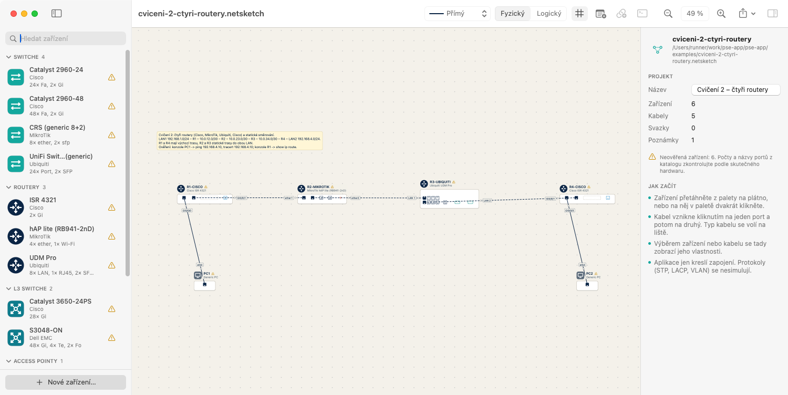
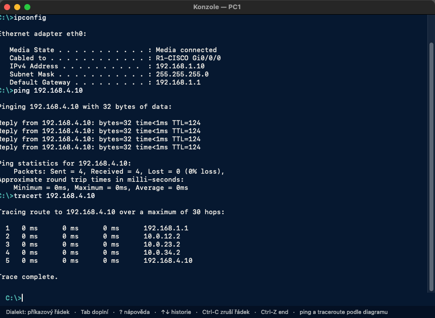
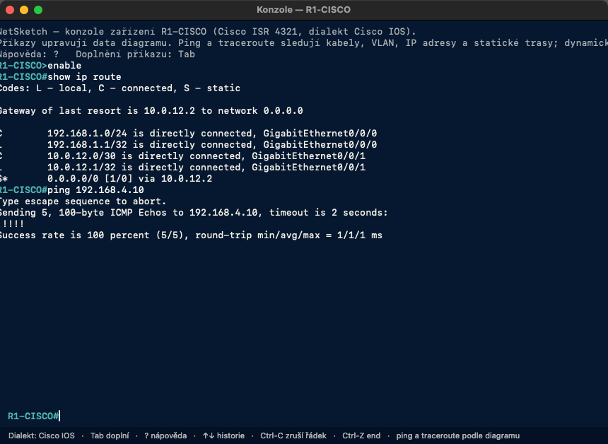
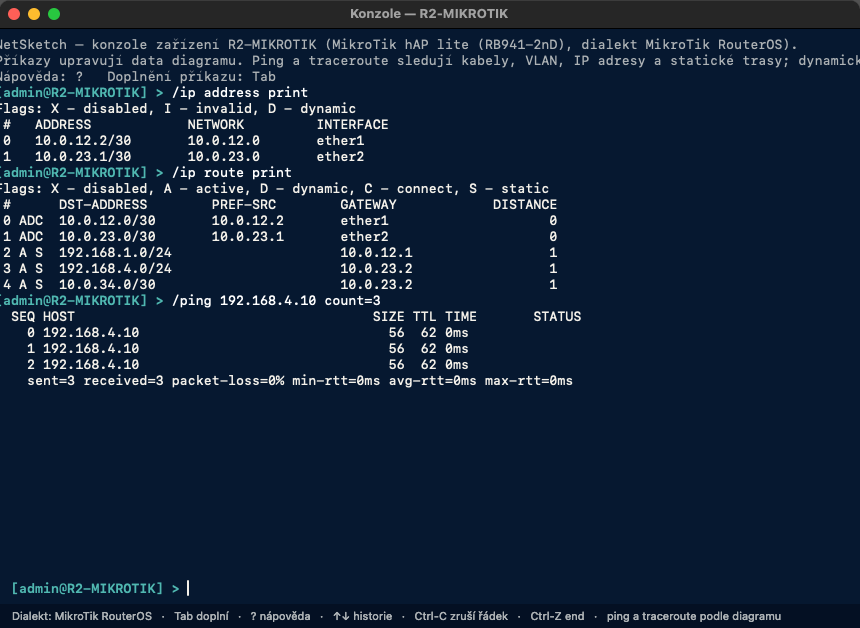
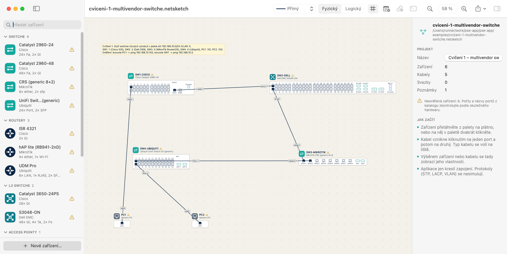
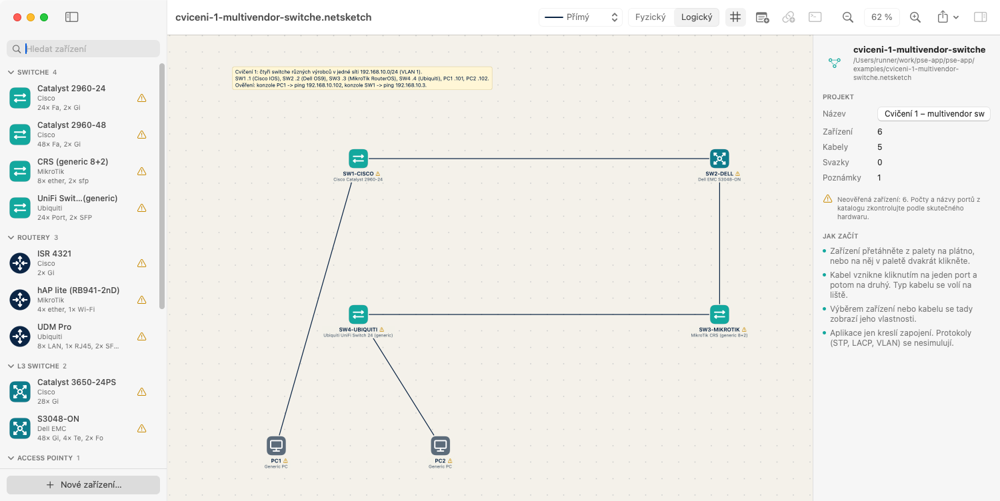
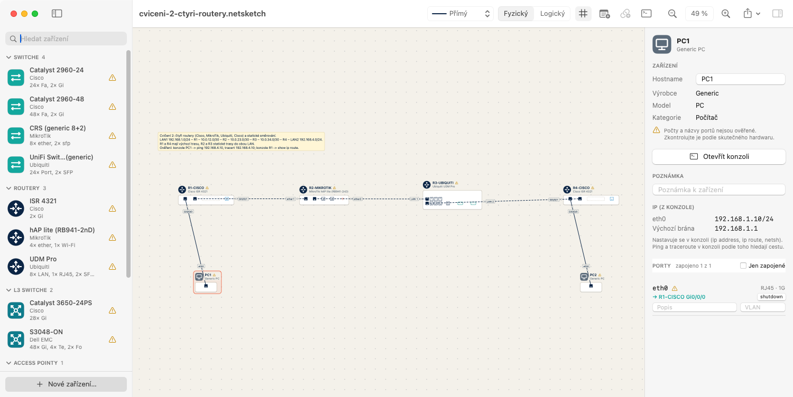
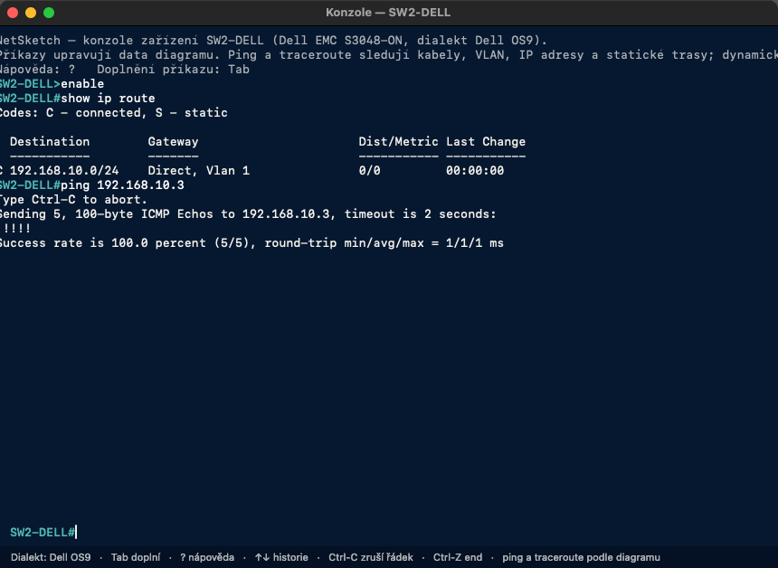

# NetSketch

**Cvičný editor počítačových sítí ve stylu Cisco Packet Tracer, který běží všude: v prohlížeči na
Windows, Linuxu i macOS, a na Macu navíc jako nativní aplikace.**

Síť se nakreslí ze zařízení z laboratoře (Cisco, Dell, MikroTik, Ubiquiti, PC), nastaví se v konzolích
jejich vlastními příkazy (Cisco IOS, Dell OS9, MikroTik RouterOS, příkazový řádek PC) a `ping` a
`traceroute` ukážou, jestli zapojení, VLAN, IP adresy a statické trasy fungují.

**Co a do jaké míry se simuluje**, viz [Rozsah simulace](#rozsah-simulace). Ve stručnosti: VLAN, IP
a statické směrování, DHCP, ACL, NAT, časy odezvy a ztrátovost s animací paketů, STP/RSTP/MST a (v konzoli Cisco IOS) OSPF a RIP; LACP
a konzole EdgeOS se zatím nesimulují.

| Verze | Kde běží | Technologie |
|---|---|---|
| **Webová** ([`web/`](web/)) | v prohlížeči na Windows, Linuxu i macOS | TypeScript, React, SVG |
| **Nativní macOS** | macOS 14 a novější | Swift, SwiftUI, AppKit |

Obě verze otevírají stejné soubory `.netsketch` a chovají se stejně (výstupy konzolí se shodují do
znaku, ověřují to testy).



> **Nejde o nástroj UJEP.** NetSketch není oficiální aplikace Univerzity J. E. Purkyně v Ústí nad
> Labem, nevznikl na její zakázku ani s jejím schválením. Je to soukromá cvičná aplikace studenta
> k procvičování počítačových sítí, inspirovaná vybavením laboratoře a látkou předmětu KI/PSE.
> Za obsah odpovídá autor. Není ani spojen s výrobci zařízení (Cisco, Dell, MikroTik, Ubiquiti,
> Netgear) a není jimi schválen.

> **Využití umělé inteligence.** Projekt vznikl s výrazným využitím nástroje generativní AI
> **Claude Code** (Anthropic). Prohlášení o využití AI v souladu s
> [pravidly využívání AI (SR-07-26)](https://www.fzp.ujep.cz/wp-content/uploads/2026/06/SR-07-26_Pravidla-AI.pdf):
>
> - **K čemu byla AI použita:** návrh a psaní zdrojového kódu (Swift i TypeScript), testů, CI,
>   dokumentace, katalogu zařízení a ukázkových cvičení, podle zadání a průběžných pokynů autora.
> - **Co dělal autor:** zadání a rozsah projektu, volba funkcí a technologií, průběžná kontrola
>   výsledků, spouštění a testování aplikace na Macu, podklady z laboratoře (fotka racku pro katalog
>   zařízení) a rozhodnutí o přijetí změn.
> - **Ověření výstupů AI:** automatické testy (Swift i webová verze, včetně vzájemného porovnání
>   výstupů obou verzí) a ruční vyzkoušení aplikace. Údaje o portech v katalogu zůstávají označené
>   jako neověřené, dokud nejsou zkontrolované na skutečném hardwaru.
> - Části vytvořené s AI jsou v historii repozitáře označené (`Co-Authored-By: Claude`).
>   Za obsah projektu a jeho použití odpovídá autor.

> **Testování.** Aplikace prošla jen automatickými testy a vyzkoušením autorem. **Nebyl proveden
> penetrační test** (bezpečnostní testování) **ani testování s uživateli** (studenty nebo vyučujícími).
> Je to cvičná aplikace bez záruky; chyby a připomínky jsou vítané (GitHub Issues).

**Návod s obrázky:** [docs/NetSketch-navod.pdf](docs/NetSketch-navod.pdf) (spuštění, kreslení, konzole,
IP adresy, ping a obě cvičení).

## Rychlé spuštění

**Webová verze (Windows, Linux, macOS):** potřebuje jen [Node.js](https://nodejs.org) 20 nebo novější.

```sh
cd web
npm install
npm start          # otevře aplikaci v prohlížeči (http://localhost:5173)
```

Se zvoleným cvičením: http://localhost:5173/#cviceni-1 nebo http://localhost:5173/#cviceni-2.
Podrobnosti v [web/README.md](web/README.md).

**Na školních počítačích:** webová verze běží jen v prohlížeči. Nic se neinstaluje do systému,
nepotřebuje administrátorská práva ani účet a neposílá žádná data (všechno se počítá v prohlížeči).
Nepracuje se skutečnou sítí: `ping` a ostatní příkazy jsou jen simulace nad diagramem. Jde o vlastnosti
podle návrhu, ne o výsledek bezpečnostního testu (viz poznámka o testování výše).

**macOS aplikace:** potřebuje Command Line Tools (`xcode-select --install`).

```sh
swift run NetSketch
```

## Stav (2026-10-10)

| Target | Stav |
|---|---|
| `NetSketchCore` (modely, katalog `devices.json`, `ProjectStore`, undo) | sestaví se na macOS i Linuxu; testy procházejí v CI |
| `NetSketchCLI` (konzole Cisco IOS / Dell OS9 / MikroTik RouterOS / PC, simulace sítě, cvičení) | sestaví se na macOS i Linuxu; testy v `Tests/NetSketchCLITests` procházejí v CI |
| `NetSketchCanvas` (plátno, panely, kabely, export PNG/PDF) | jen macOS; sestaví se a běží |
| `NetSketch` (aplikace: paleta, inspector, konzole, menu) | jen macOS; sestaví se a běží, konzole i ping ověřené na Macu |
| `web/` (webová verze: jádro, konzole, simulace, plátno, UI) | všechny OS; testy a build v CI, výstupy konzolí a soubory cvičení shodné se Swift verzí |

CI (GitHub Actions, `.github/workflows/ci.yml`):

- každý push: Linux sestaví Core a CLI, spustí testy, postaví cvičení přes konzole a při změně je
  commitne do `examples/` (soubory i výstupy konzolí v `examples/UKAZKA.md`);
- commit se značkou `[screenshots]` ve zprávě: macOS navíc sestaví celou aplikaci a vyrenderuje
  diagramy z `examples/` do `docs/screenshots/` (minuty macOS jsou u soukromého repa drahé, proto
  jen na vyžádání).

## Sestavení a spuštění (macOS 14+)

Stačí Command Line Tools (`xcode-select --install`), Xcode není nutný.

```sh
swift build
swift run NetSketch                 # spustí aplikaci přímo
swift run NetSketch --selftest      # automatický průchod hlavními funkcemi, vypíše ok/FAIL
scripts/make-app.sh                 # sestaví build/NetSketch.app (release, ad-hoc podpis)
open build/NetSketch.app
```

Testy bez Xcode (jen Command Line Tools), viz komentář v Package.swift:

```sh
swift test -Xswiftc -F -Xswiftc /Library/Developer/CommandLineTools/Library/Developer/Frameworks
```

Na Linuxu (Swift 6.x) se sestaví a otestují jen Core a CLI: `swift build && swift test`.
Package.swift na jiných systémech než macOS Canvas a aplikaci vůbec nedeklaruje.

Příklad projektu: `examples/trojuhelnik.netsketch` (Soubor > Otevřít).

## Cvičení

| Soubor | Obsah |
|---|---|
| `examples/cviceni-1-multivendor-switche.netsketch` | 4 switche (Cisco, Dell, MikroTik, Ubiquiti) v síti 192.168.10.0/24, management IP na VLAN 1, 2 PC; ping mezi všemi |
| `examples/cviceni-2-ctyri-routery.netsketch` | 4 routery (Cisco, MikroTik, Ubiquiti, Cisco), propoje /30, statické trasy, PC v LAN 192.168.1.0/24 a 192.168.4.0/24 |

Výstupy konzolí z hotových cvičení (ipconfig, ping, tracert, show ip route, ...) a obrázky diagramů
jsou v [examples/UKAZKA.md](examples/UKAZKA.md).

Cvičení jsou definovaná v `Sources/NetSketchCLI/Exercises.swift` a sestavená přes konzole zařízení
(stejnými příkazy, jaké by psal student). `swift run NetSketchExamples` je uloží do `examples/`,
CI je při změně samo přegeneruje a commitne a testy ověřují, že všechny pingy v nich projdou.

## Obrázky

Konzole PC1 ve cvičení 2: `ipconfig`, `ping` a `tracert` přes čtyři routery.



| Cisco IOS (R1): `show ip route`, `ping` | MikroTik RouterOS (R2): `/ip address print`, `/ip route print`, `/ping` |
|---|---|
|  |  |

| Cvičení 1, fyzický pohled | Cvičení 1, logický pohled |
|---|---|
|  |  |

| Inspector vybraného PC (IP z konzole) | Dell OS9 (SW2): `show ip route`, `ping` |
|---|---|
|  |  |

Celé diagramy vyrenderované exportem (PNG):
[cvičení 1](docs/screenshots/cviceni-1-multivendor-switche-fyzicky.png),
[cvičení 1 logicky](docs/screenshots/cviceni-1-multivendor-switche-logicky.png),
[cvičení 2](docs/screenshots/cviceni-2-ctyri-routery-fyzicky.png),
[cvičení 2 logicky](docs/screenshots/cviceni-2-ctyri-routery-logicky.png),
[trojúhelník](docs/screenshots/trojuhelnik-fyzicky.png).

Obrázky vytváří CI na macOS (`swift run NetSketch --screenshots=docs/screenshots` a `NetSketchRender`)
pro commity se značkou `[screenshots]`.

## Simulace sítě

Konzole ukládají IP konfiguraci do projektu, `ping` a `traceroute` ji vyhodnocují nad diagramem:

- L2: switch přepíná podle VLAN na portech (access, trunk, allowed VLAN, native VLAN), kabel spojí
  to, co nesou oba konce, `shutdown` port vypne. Smyčky řeší STP (viz níže): zablokovaný port provoz nepustí.
- L3: adresy na portech routerů, na VLAN rozhraních switchů (SVI, MikroTik `bridge`) a na PC,
  připojené sítě, statické trasy, výchozí brána. Routery a L3 switche směrují, PC a L2 switche ne.
- Když ping neprojde, konzole česky napíše, kde a proč se paket zastavil.
- Co všechno se simuluje a co ne, shrnuje [Rozsah simulace](#rozsah-simulace) níže.

| Zařízení | Adresa | Trasy a brána | Test |
|---|---|---|---|
| Cisco IOS (a obecný dialekt) | `interface gi0/0/0` / `interface vlan 1`, `ip address A.B.C.D M.M.M.M` | `ip route NET MASK NEXTHOP`, `ip default-gateway X` | `ping`, `traceroute`, `show ip route`, `show ip interface brief` |
| Dell OS9 | `interface vlan 1`, `ip address A.B.C.D/NN` | `ip route NET/NN NEXTHOP` | `ping`, `traceroute`, `show ip route` |
| MikroTik RouterOS | `/ip address add address=A.B.C.D/NN interface=ether1` (switch: `interface=bridge`) | `/ip route add dst-address=NET/NN gateway=X` | `/ping X`, `/ip route print` |
| PC, server | `netsh interface ip set address eth0 static A.B.C.D M.M.M.M [BRÁNA]` | brána v témže příkazu | `ipconfig`, `ping`, `tracert` |

Konzoli otevře Cmd+T (nebo tlačítko na liště či v inspectoru) u vybraného zařízení; nemají ji jen
access pointy. Inspector u zařízení ukazuje adresy, bránu a trasy nastavené v konzoli.

## Rozsah simulace

NetSketch **není emulátor firmwaru**: nespouští skutečný software zařízení (žádný IOS, RouterOS ani
Linux). Konzole jsou věrné napodobeniny příkazového řádku a výsledky (`ping`, `traceroute`, `show ...`)
se počítají z diagramu a uložené konfigurace. Cílem je procvičit zapojení a příkazy, ne reprodukovat
každý detail skutečného zařízení.

Značení: **ano** = funguje a má testy, **zjednodušeně** = funguje, ale s uvedenými omezeními,
**jen data** = konfigurace se ukládá a kreslí, ale nemá žádný vliv na provoz, **ne** = nepodporováno.
Sloupec „Web“ platí pro webovou verzi, sloupec „macOS“ pro nativní aplikaci.

### Konzole

| Zařízení | Web | macOS | Co umí |
|---|---|---|---|
| Cisco IOS | ano | ano | režimy user / privileged / config / interface (i `range`) / vlan / SVI; `show` (running-config, interfaces, vlan, ip route, ip interface brief, ...), `ping`, `traceroute`, konfigurace VLAN, switchportů, IP, tras |
| Dell OS9 | ano | ano | vlastní syntaxe a hlášky (`interface vlan`, `untagged` / `tagged`, `ip address A/NN`), `show` výpisy ve stylu OS9 |
| Dell OS6 (N-série: N3024, N1124T-ON) | jen web | ne | DNOS 6.x: `enable` / `configure`, `interface gi1/0/1` a `interface range gi1/0/3-24`, `vlan 10` + `name`, `switchport mode access/trunk/general`, `switchport trunk allowed vlan add/remove/all`, `interface vlan 10` + `ip address A.B.C.D MASKA`, `ip default-gateway`, `ip route`, `spanning-tree` (mode, priority, portfast, cost), `show vlan` / `interfaces status` / `interfaces switchport` / `ip interface vlan N` / `ip route` / `running-config` / `spanning-tree`, `ping`, `traceroute`, `write memory`, `clear config`. Chybí port-channel, routované porty, `show mac-address-table` a `show arp` (jen hláška), režim `general` se ukládá jako trunk; přesný text některých hlášek je odhad |
| MikroTik RouterOS | zjednodušeně | zjednodušeně | `/interface ethernet`, `/ip address`, `/ip route`, `/system identity`, `/ping`, `/export`; ve webu navíc DHCP, firewall a NAT. Chybí `/interface vlan`, `bridge`, `bonding` a `/routing` |
| PC, server (Windows styl) | ano | ano | `ipconfig` (`/all`, `/renew`, `/release`), `netsh interface ip set address`, `ping`, `tracert`; web navíc `Test-NetConnection` a `telnet IP port` |
| Ubiquiti UniFi, Netgear, ostatní | zjednodušeně | zjednodušeně | obecná syntaxe ve stylu IOS (skutečné zařízení se nastavuje ve webovém rozhraní) |
| Ubiquiti EdgeOS | ne | ne | prompt a `exit`, jinak jen hláška „konzole EdgeOS se připravuje“ |

Společné vlastnosti konzolí: zkratky příkazů (`conf t`, `sh run`), `?` nápověda, `Tab` doplňování,
historie šipkami a `show history`, typické chyby (`% Invalid input detected at '^' marker.`,
`% Incomplete command.`, `% Ambiguous command`, u RouterOS `bad command name ...`), `exit` / `end` /
`Ctrl-Z`. Každý příkaz je jeden krok Undo. Konfigurace se ukládá do projektu (souboru `.netsketch`),
ne do relace.

Příkazy, které vyžadují simulaci, jakou NetSketch nemá (`telnet`, `ssh`, `reload`, `debug`, `nslookup`, `netstat`, ...), se rozpoznají a odpoví
vysvětlením, ale nic neprovedou. Nastavení, které se jen přijme (`banner`, `line`, `mtu`, port-security),
se neukládá a konzole to řekne.

### Síť

| Oblast | Web | macOS | Rozsah |
|---|---|---|---|
| VLAN, access / trunk, allowed a native VLAN | ano | ano | kabel spojí to, co nesou oba konce; `shutdown` a chybějící kabel port vypnou; chybějící VLAN v tabulce se hlásí |
| Přepínání (switch, AP) | zjednodušeně | zjednodušeně | počítá se dosažitelnost v L2 doméně; neflooduje se. Jen web: Cisco IOS má `show mac address-table` a `show arp` / `show ip arp` s tabulkami plněnými provozem (ping), bez stárnutí, `clear mac address-table dynamic`, `clear arp-cache`; ostatní výrobci a macOS tabulky MAC ani ARP nemají; viz [docs/protokoly/mac-arp.md](docs/protokoly/mac-arp.md) |
| IP adresy, připojené a statické trasy, výchozí brána | ano | ano | routery a L3 switche směrují, PC a L2 switche ne; inter-VLAN přes SVI nebo router; hlídá duplicitní adresy a neaktivní trasy; jedna adresa na rozhraní, **bez IPv6** |
| Proč ping neprošel | ano | ano | česká věta, kde a proč se paket zastavil |
| DHCP (server, relay, klient) | zjednodušeně | ne | Cisco, Dell, MikroTik; přidělí se nejnižší volná adresa a zapíše se jako jeden krok Undo; **neplyne čas**, zápůjčka nevyprší; chybí options, rezervace podle MAC a více podsítí v jednom poolu |
| ACL / firewall | zjednodušeně | ne | Cisco standardní, rozšířené a pojmenované ACL, Dell ACL, MikroTik `/ip firewall filter`; ip / icmp / tcp / udp, `eq` `gt` `lt` `range`, implicitní deny, `established` (heuristikou, **spojení se nesleduje**); chybí `time-range`, počítadla zásahů, `jump` |
| NAT / PAT | zjednodušeně | ne | Cisco statický, dynamický a `overload`, MikroTik `masquerade` / `src-nat` / `dst-nat`; překladová tabulka je jen běhový stav a nevyprší; chybí `outside source`, statický překlad portů a NAT na Dell OS9 |
| Čas odezvy a ztrátovost | zjednodušeně | ne | zpoždění (ms) a ztrátovost (%) se nastavují na kabelu; jitter a ztráty jsou **deterministické**, ne náhodné; bez šířky pásma a front |
| Animace paketů | ano | ne | cesta žádosti a odpovědi po kabelech, zahozený paket skončí červeným křížkem; animuje se jen první echo příkazu |
| STP / RSTP / MST | zjednodušeně | ne | jeden strom pro celou L2 doménu (MST instance 0 a rapid-pvst se chovají stejně), volba rootu, role a stavy portů, zablokovaný port zahodí provoz, failover po odpojení kabelu; Cisco, Dell OS9 a OS6, MikroTik a UniFi. Chybí strom na VLAN (priorita a cena na VLAN se jen ukládají), více MST instancí, časovače a BPDU guard v chování; ceny vždy podle dlouhé škály; viz [docs/protokoly/stp.md](docs/protokoly/stp.md) |
| Port-channel, LACP, PAgP | zjednodušeně (jen Cisco IOS) | jen data | Cisco: `interface port-channel N` (switchport, trunk, popis, `shutdown`, na routeru `ip address`), `channel-group N mode active/passive/on/desirable/auto`, `show etherchannel summary`, `show interfaces port-channel N`; svazek se chová jako jeden spoj (člen dole = zbytek nese provoz, všichni dole = svazek dole), kontrola shody módů obou konců, v STP jako jeden port (cena podle součtu rychlostí). Chybí load-balancing, `min-links`, `lacp port-priority`, kontrola shody rychlosti a duplexu členů, L3 port-channel na přepínači; ostatní výrobci zůstávají jen kresba; viz [docs/protokoly/etherchannel.md](docs/protokoly/etherchannel.md) |
| OSPF, RIP | zjednodušeně (jen webová verze, jen Cisco IOS) | ne | `router ospf` / `router rip`, `network`, `router-id`, `passive-interface`, `ip ospf cost`; sousedé na propojených rozhraních, trasy `O` / `O IA` / `R` v `show ip route`, `show ip ospf neighbor`, `show ip protocols`, ping přes naučené trasy, po odpojení kabelu nebo `shutdown` trasy zmizí. OSPF: jeden proces, cena podle šířky pásma, Dijkstra bez LSA databáze, bez ECMP; RIP: počet skoků, split horizon, auto-summary. Chybí redistribuce, `default-information originate`, autentizace, časovače; MikroTik, Dell a EdgeOS zatím jen data; viz [docs/protokoly/ospf-rip.md](docs/protokoly/ospf-rip.md) |
| VTP, DTP, port-security, HSRP, EIGRP, QoS, VRF, DNS, SNMP | ne | ne | |

### Co si z toho odnést

- Spolehlivě lze procvičit: zapojení a kabeláž, VLAN a trunky, adresaci, statické směrování,
  inter-VLAN routing, DHCP, filtrování pomocí ACL a NAT, a hlavně **psaní příkazů** několika výrobců.
- Nelze procvičit: chování protokolů v čase (dynamické směrování, LACP), diagnostiku přes tabulky
  MAC a ARP u jiných než Cisco IOS (a vše v čase: stárnutí záznamů), výkon (šířka pásma, přetížení) a vše, co spoléhá na skutečný firmware.
- Výstupy výpisů jsou psané tak, aby se podobaly skutečným zařízením, ale **nejsou s nimi porovnané**
  na hardwaru (porty v katalogu jsou označené jako neověřené). Neberte je jako referenci pro
  zkoušku nebo ostrý provoz.
- Web a macOS se liší: macOS aplikace zůstává u základu (VLAN, IP, statické trasy, `ping`,
  `traceroute`), DHCP, ACL, NAT, zpoždění a animace paketů jsou jen ve webové verzi. Soubor
  `.netsketch` otevřou obě verze, ale konfiguraci protokolů uloženou webem macOS ignoruje a při uložení ji
  ztratí.
- Podrobnosti a zjednodušení jednotlivých funkcí: [docs/protokoly/](docs/protokoly/).

## Ubiquiti

Zařízení **UniFi** (UDM Pro, UniFi Switch, USG) se ve skutečnosti nenastavují příkazovou řádkou, ale
ve webovém rozhraní **UniFi Network** (Controller); ruční změny v jejich konzoli Controller při další
synchronizaci přepíše. Skutečné konfigurační CLI mají jen routery s **EdgeOS** (EdgeRouter, v omezené
míře USG): `configure`, `set interfaces ethernet eth0 address …`, `commit`, `save`.

| Zařízení | Konzole v NetSketch |
|---|---|
| UDM Pro, UniFi Switch 24 | obecná syntaxe ve stylu Cisco IOS: zjednodušení místo Controlleru, používají ji cvičení 1 a 2 |
| USG Pro 4, EdgeRouter X | zatím obecná syntaxe ve stylu Cisco IOS (konzole `ubnt@…` s EdgeOS ve webu je zatím jen prázdný stub bez příkazů `set` / `commit`) |
| Netgear FS726T a ostatní | obecná syntaxe ve stylu Cisco IOS (skutečný přepínač se nastavuje ve webovém rozhraní) |

## Katalog zařízení

`Sources/NetSketchCore/Resources/devices.json`. Podle fotky racku v laboratoři přibyly Cisco 2811,
Catalyst 3550-48 a 3750-48PS, MikroTik CRS326-24G-2S+RM, Ubiquiti USG Pro 4 a Netgear FS726T, navíc
Ubiquiti EdgeRouter X. Všechny počty a názvy portů mají `"verified": false`
a je nutné je ověřit podle skutečného hardwaru. Formát katalogu, vlastní zařízení a textový formát
VLAN, který zapisuje konzole, popisuje [docs/katalog.md](docs/katalog.md).

## Mimo rozsah

Emulace firmware (NetSketch nespouští skutečný software zařízení) a vše, co je v tabulkách výše
označené „ne“. LACP má zatím jen datový model, bez simulace chování; OSPF a RIP se simulují jen v konzoli Cisco IOS webové verze.

## Licence

Kód je pod licencí [MIT](LICENSE): lze ho volně používat, upravovat i šířit, jen je potřeba ponechat
uvedení autora a text licence. Názvy výrobců a modelů zařízení v katalogu (Cisco, Dell, MikroTik,
Ubiquiti, Netgear) jsou ochranné známky svých vlastníků a slouží jen k označení zařízení.
NetSketch není spojen s firmami Cisco, Dell, MikroTik, Ubiquiti ani Netgear a není jimi schválen;
licence MIT se na jejich ochranné známky nevztahuje.
