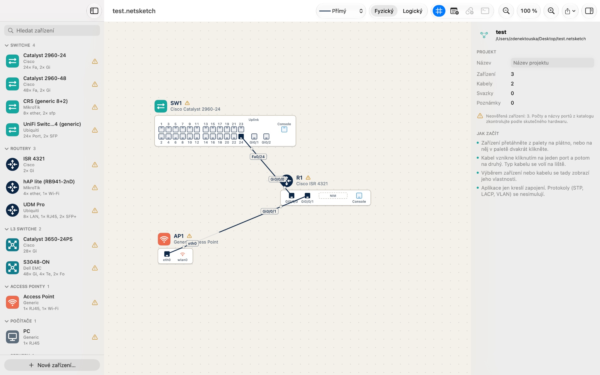

# pse-app (NetSketch)

Nativní macOS aplikace (Swift + SwiftUI, macOS 14+, Swift Package): vizuální editor síťové topologie
ve stylu Cisco Packet Tracer pro KI/PSE (UJEP). Zařízení se kreslí a propojují na plátně, konfigurují
v konzolích podle výrobce (Cisco IOS, Dell OS9, MikroTik RouterOS, příkazový řádek PC) a `ping` /
`traceroute` mezi nimi opravdu prochází podle kabeláže, VLAN, IP adres a statických tras.



## Stav (2026-10-10)

| Target | Stav |
|---|---|
| `NetSketchCore` (modely, katalog `devices.json`, `ProjectStore`, undo) | sestaví se na macOS i Linuxu; testy procházejí v CI |
| `NetSketchCLI` (konzole Cisco IOS / Dell OS9 / MikroTik RouterOS / PC, simulace sítě, cvičení) | sestaví se na macOS i Linuxu; testy v `Tests/NetSketchCLITests` procházejí v CI |
| `NetSketchCanvas` (plátno, panely, kabely, export PNG/PDF) | jen macOS; opravy tažení a hit-testu, ověřuje se na Macu |
| `NetSketch` (aplikace: paleta, inspector, konzole, menu) | jen macOS; dokončeno, chyby z prvního sestavení na Macu opraveny |

CI (GitHub Actions, `.github/workflows/ci.yml`): na každý push se na Linuxu sestaví a otestuje
Core a CLI. Sestavení celé aplikace na macOS se spouští ručně (Actions -> CI -> Run workflow),
protože minuty macOS jsou u soukromého repa drahé.

## Sestavení a spuštění (macOS 14+)

Stačí Command Line Tools (`xcode-select --install`), Xcode není nutný.

```sh
swift build
swift run NetSketch                 # spustí aplikaci přímo
swift run NetSketch --selftest      # automatický průchod hlavními funkcemi, vypíše ok/FAIL
scripts/make-app.sh                 # sestaví build/NetSketch.app (release, ad-hoc podpis)
open build/NetSketch.app
```

Testy bez Xcode (jen Command Line Tools), viz komentář v Package.swift:

```sh
swift test -Xswiftc -F -Xswiftc /Library/Developer/CommandLineTools/Library/Developer/Frameworks
```

Na Linuxu (Swift 6.x) se sestaví a otestují jen Core a CLI: `swift build && swift test`.
Package.swift na jiných systémech než macOS Canvas a aplikaci vůbec nedeklaruje.

Příklad projektu: `examples/trojuhelnik.netsketch` (Soubor > Otevřít).

## Cvičení

| Soubor | Obsah |
|---|---|
| `examples/cviceni-1-multivendor-switche.netsketch` | 4 switche (Cisco, Dell, MikroTik, Ubiquiti) v síti 192.168.10.0/24, management IP na VLAN 1, 2 PC; ping mezi všemi |
| `examples/cviceni-2-ctyri-routery.netsketch` | 4 routery (Cisco, MikroTik, Ubiquiti, Cisco), propoje /30, statické trasy, PC v LAN 192.168.1.0/24 a 192.168.4.0/24 |

Výstupy konzolí z hotových cvičení (ipconfig, ping, tracert, show ip route, ...) a obrázky diagramů
jsou v [examples/UKAZKA.md](examples/UKAZKA.md).

Cvičení jsou definovaná v `Sources/NetSketchCLI/Exercises.swift` a sestavená přes konzole zařízení
(stejnými příkazy, jaké by psal student). `swift run NetSketchExamples` je uloží do `examples/`,
CI je při změně samo přegeneruje a commitne a testy ověřují, že všechny pingy v nich projdou.

## Simulace sítě

Konzole ukládají IP konfiguraci do projektu, `ping` a `traceroute` ji vyhodnocují nad diagramem:

- L2: switch přepíná podle VLAN na portech (access, trunk, allowed VLAN, native VLAN), kabel spojí
  to, co nesou oba konce, `shutdown` port vypne. Smyčky nevadí (STP se nesimuluje).
- L3: adresy na portech routerů, na VLAN rozhraních switchů (SVI, MikroTik `bridge`) a na PC,
  připojené sítě, statické trasy, výchozí brána. Routery a L3 switche směrují, PC a L2 switche ne.
- Když ping neprojde, konzole česky napíše, kde a proč se paket zastavil.
- Nesimuluje se: STP, OSPF a jiné dynamické směrování, DHCP, ACL, NAT, časování.

| Zařízení | Adresa | Trasy a brána | Test |
|---|---|---|---|
| Cisco IOS (a obecný dialekt) | `interface gi0/0/0` / `interface vlan 1`, `ip address A.B.C.D M.M.M.M` | `ip route NET MASK NEXTHOP`, `ip default-gateway X` | `ping`, `traceroute`, `show ip route`, `show ip interface brief` |
| Dell OS9 | `interface vlan 1`, `ip address A.B.C.D/NN` | `ip route NET/NN NEXTHOP` | `ping`, `traceroute`, `show ip route` |
| MikroTik RouterOS | `/ip address add address=A.B.C.D/NN interface=ether1` (switch: `interface=bridge`) | `/ip route add dst-address=NET/NN gateway=X` | `/ping X`, `/ip route print` |
| PC, server | `netsh interface ip set address eth0 static A.B.C.D M.M.M.M [BRÁNA]` | brána v témže příkazu | `ipconfig`, `ping`, `tracert` |

Konzoli otevře Cmd+T (nebo tlačítko na liště či v inspectoru) u vybraného zařízení; nemají ji jen
access pointy. Inspector u zařízení ukazuje adresy, bránu a trasy nastavené v konzoli.

## Katalog zařízení

`Sources/NetSketchCore/Resources/devices.json`. Všechny počty a názvy portů mají `"verified": false`
a je nutné je ověřit podle skutečného hardwaru. Formát katalogu, vlastní zařízení a textový formát
VLAN, který zapisuje konzole, popisuje [docs/katalog.md](docs/katalog.md).

## Mimo rozsah

Simulace STP/RSTP/MSTP, LACP, dynamického směrování (OSPF, RIP), DHCP, ACL a NAT, emulace firmware.
