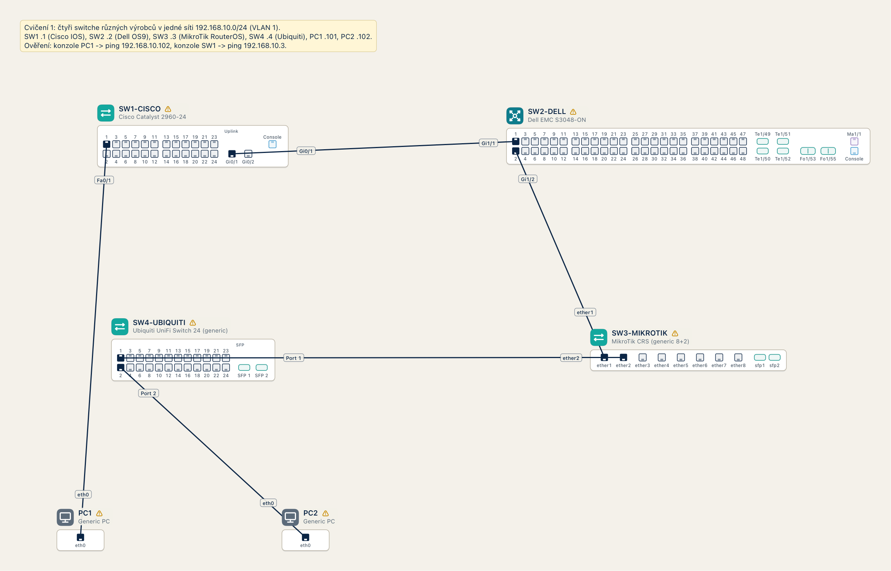
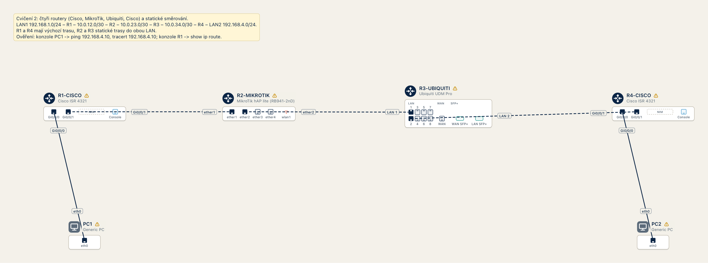

# Ukázka cvičení

Výstupy konzolí z hotových cvičení, tak jak je vypíše NetSketch (generuje `swift run NetSketchExamples`).
Obrázky diagramů vyrenderuje `NetSketchRender` na macOS.

## Cvičení 1: komunikace čtyř multivendor switchů

Soubor: `examples/cviceni-1-multivendor-switche.netsketch`



### PC1

```
C:\> ipconfig

Ethernet adapter eth0:

   Media State . . . . . . . . . . . : Media connected
   Cabled to . . . . . . . . . . . . : SW1-CISCO Fa0/1
   IPv4 Address . . . . . . . . . .  : 192.168.10.101
   Subnet Mask . . . . . . . . . . . : 255.255.255.0
   Default Gateway . . . . . . . . . : 0.0.0.0
C:\> ping 192.168.10.102

Pinging 192.168.10.102 with 32 bytes of data:

Reply from 192.168.10.102: bytes=32 time<1ms TTL=128
Reply from 192.168.10.102: bytes=32 time<1ms TTL=128
Reply from 192.168.10.102: bytes=32 time<1ms TTL=128
Reply from 192.168.10.102: bytes=32 time<1ms TTL=128

Ping statistics for 192.168.10.102:
    Packets: Sent = 4, Received = 4, Lost = 0 (0% loss),
Approximate round trip times in milli-seconds:
    Minimum = 0ms, Maximum = 0ms, Average = 0ms
```

### SW1-CISCO

```
SW1-CISCO> enable
SW1-CISCO# show ip interface brief
Interface              IP-Address      OK? Method Status                Protocol
FastEthernet0/1        unassigned      YES unset  up                    up
FastEthernet0/2        unassigned      YES unset  down                  down
FastEthernet0/3        unassigned      YES unset  down                  down
FastEthernet0/4        unassigned      YES unset  down                  down
FastEthernet0/5        unassigned      YES unset  down                  down
FastEthernet0/6        unassigned      YES unset  down                  down
FastEthernet0/7        unassigned      YES unset  down                  down
FastEthernet0/8        unassigned      YES unset  down                  down
FastEthernet0/9        unassigned      YES unset  down                  down
FastEthernet0/10       unassigned      YES unset  down                  down
FastEthernet0/11       unassigned      YES unset  down                  down
FastEthernet0/12       unassigned      YES unset  down                  down
FastEthernet0/13       unassigned      YES unset  down                  down
FastEthernet0/14       unassigned      YES unset  down                  down
FastEthernet0/15       unassigned      YES unset  down                  down
FastEthernet0/16       unassigned      YES unset  down                  down
FastEthernet0/17       unassigned      YES unset  down                  down
FastEthernet0/18       unassigned      YES unset  down                  down
FastEthernet0/19       unassigned      YES unset  down                  down
FastEthernet0/20       unassigned      YES unset  down                  down
FastEthernet0/21       unassigned      YES unset  down                  down
FastEthernet0/22       unassigned      YES unset  down                  down
FastEthernet0/23       unassigned      YES unset  down                  down
FastEthernet0/24       unassigned      YES unset  down                  down
GigabitEthernet0/1     unassigned      YES unset  up                    up
GigabitEthernet0/2     unassigned      YES unset  down                  down
Vlan1                  192.168.10.1    YES manual up                    up
NetSketch: stav rozhraní plyne z kabeláže v diagramu a z příkazu shutdown.
SW1-CISCO# ping 192.168.10.3
Type escape sequence to abort.
Sending 5, 100-byte ICMP Echos to 192.168.10.3, timeout is 2 seconds:
!!!!!
Success rate is 100 percent (5/5), round-trip min/avg/max = 1/1/1 ms
```

### SW2-DELL

```
SW2-DELL> enable
SW2-DELL# show ip route
Codes: C - connected, S - static

  Destination        Gateway                      Dist/Metric Last Change
  -----------        -------                      ----------- -----------
C 192.168.10.0/24    Direct, Vlan 1               0/0         00:00:00
SW2-DELL# ping 192.168.10.4
Type Ctrl-C to abort.
Sending 5, 100-byte ICMP Echos to 192.168.10.4, timeout is 2 seconds:
!!!!!
Success rate is 100.0 percent (5/5), round-trip min/avg/max = 1/1/1 ms
```

### SW3-MIKROTIK

```
[admin@SW3-MIKROTIK] > /ip address print
Flags: X - disabled, I - invalid, D - dynamic
 #   ADDRESS            NETWORK         INTERFACE
 0   192.168.10.3/24    192.168.10.0    bridge
[admin@SW3-MIKROTIK] > /ping 192.168.10.101 count=3
  SEQ HOST                                     SIZE TTL TIME       STATUS
    0 192.168.10.101                             56  64 0ms
    1 192.168.10.101                             56  64 0ms
    2 192.168.10.101                             56  64 0ms
    sent=3 received=3 packet-loss=0% min-rtt=0ms avg-rtt=0ms max-rtt=0ms
```

## Cvičení 2: čtyři routery a statické směrování

Soubor: `examples/cviceni-2-ctyri-routery.netsketch`



### PC1

```
C:\> ipconfig

Ethernet adapter eth0:

   Media State . . . . . . . . . . . : Media connected
   Cabled to . . . . . . . . . . . . : R1-CISCO Gi0/0/0
   IPv4 Address . . . . . . . . . .  : 192.168.1.10
   Subnet Mask . . . . . . . . . . . : 255.255.255.0
   Default Gateway . . . . . . . . . : 192.168.1.1
C:\> ping 192.168.4.10

Pinging 192.168.4.10 with 32 bytes of data:

Reply from 192.168.4.10: bytes=32 time<1ms TTL=124
Reply from 192.168.4.10: bytes=32 time<1ms TTL=124
Reply from 192.168.4.10: bytes=32 time<1ms TTL=124
Reply from 192.168.4.10: bytes=32 time<1ms TTL=124

Ping statistics for 192.168.4.10:
    Packets: Sent = 4, Received = 4, Lost = 0 (0% loss),
Approximate round trip times in milli-seconds:
    Minimum = 0ms, Maximum = 0ms, Average = 0ms
C:\> tracert 192.168.4.10

Tracing route to 192.168.4.10 over a maximum of 30 hops:

  1   0 ms      0 ms      0 ms      192.168.1.1
  2   0 ms      0 ms      0 ms      10.0.12.2
  3   0 ms      0 ms      0 ms      10.0.23.2
  4   0 ms      0 ms      0 ms      10.0.34.2
  5   0 ms      0 ms      0 ms      192.168.4.10

Trace complete.
```

### R1-CISCO

```
R1-CISCO> enable
R1-CISCO# show ip route
Codes: L - local, C - connected, S - static

Gateway of last resort is 10.0.12.2 to network 0.0.0.0

C        192.168.1.0/24 is directly connected, GigabitEthernet0/0/0
L        192.168.1.1/32 is directly connected, GigabitEthernet0/0/0
C        10.0.12.0/30 is directly connected, GigabitEthernet0/0/1
L        10.0.12.1/32 is directly connected, GigabitEthernet0/0/1
S*       0.0.0.0/0 [1/0] via 10.0.12.2
R1-CISCO# show ip interface brief
Interface              IP-Address      OK? Method Status                Protocol
GigabitEthernet0/0/0   192.168.1.1     YES manual up                    up
GigabitEthernet0/0/1   10.0.12.1       YES manual up                    up
NetSketch: stav rozhraní plyne z kabeláže v diagramu a z příkazu shutdown.
R1-CISCO# ping 192.168.4.10
Type escape sequence to abort.
Sending 5, 100-byte ICMP Echos to 192.168.4.10, timeout is 2 seconds:
!!!!!
Success rate is 100 percent (5/5), round-trip min/avg/max = 1/1/1 ms
```

### R2-MIKROTIK

```
[admin@R2-MIKROTIK] > /ip address print
Flags: X - disabled, I - invalid, D - dynamic
 #   ADDRESS            NETWORK         INTERFACE
 0   10.0.12.2/30       10.0.12.0       ether1
 1   10.0.23.1/30       10.0.23.0       ether2
[admin@R2-MIKROTIK] > /ip route print
Flags: X - disabled, A - active, D - dynamic, C - connect, S - static
 #      DST-ADDRESS        PREF-SRC        GATEWAY            DISTANCE
 0 ADC  10.0.12.0/30       10.0.12.2       ether1                    0
 1 ADC  10.0.23.0/30       10.0.23.1       ether2                    0
 2 A S  192.168.1.0/24                     10.0.12.1                 1
 3 A S  192.168.4.0/24                     10.0.23.2                 1
 4 A S  10.0.34.0/30                       10.0.23.2                 1
[admin@R2-MIKROTIK] > /ping 192.168.1.10 count=3
  SEQ HOST                                     SIZE TTL TIME       STATUS
    0 192.168.1.10                               56  63 0ms
    1 192.168.1.10                               56  63 0ms
    2 192.168.1.10                               56  63 0ms
    sent=3 received=3 packet-loss=0% min-rtt=0ms avg-rtt=0ms max-rtt=0ms
```

### R3-UBIQUITI

```
R3-UBIQUITI> enable
R3-UBIQUITI# show ip route
Codes: L - local, C - connected, S - static

Gateway of last resort is not set

C        10.0.23.0/30 is directly connected, LAN 1
L        10.0.23.2/32 is directly connected, LAN 1
C        10.0.34.0/30 is directly connected, LAN 2
L        10.0.34.1/32 is directly connected, LAN 2
S        192.168.4.0/24 [1/0] via 10.0.34.2
S        192.168.1.0/24 [1/0] via 10.0.23.1
S        10.0.12.0/30 [1/0] via 10.0.23.1
R3-UBIQUITI# traceroute 192.168.1.10
Type escape sequence to abort.
Tracing the route to 192.168.1.10

  1 10.0.23.1 0 msec 0 msec 0 msec
  2 10.0.12.1 0 msec 0 msec 0 msec
  3 192.168.1.10 0 msec 0 msec 0 msec
```
